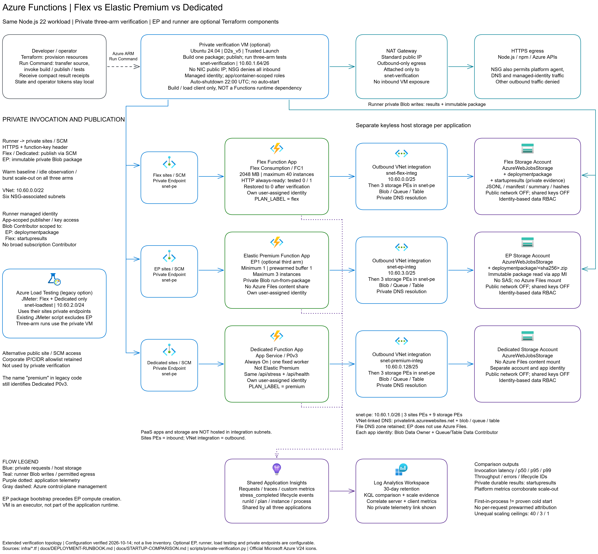

# func-premium-vs-flex

A reproducible **cost and performance** comparison between **Azure Functions
Flex Consumption** and an **always-on, reserved-capacity plan (App Service
Dedicated, P0v3)** under the **same parallel workload**. The environment is
deployed entirely with **Terraform** and follows Azure **Well-Architected
Framework (WAF)** practices.

> This is a **demo**: it uses small, economical SKUs intended to be reasonably
> comparable (Flex 2048 MB vs P0v3, approximately 1 vCPU / 4 GB).

> **Elastic Premium (EP) note:** the original design used **Elastic Premium
> (EP1)**. In the demo subscription, **Azure Policy** disables storage shared
> keys (`allowSharedKeyAccess=false`) and public access
> (`publicNetworkAccess=Disabled`). The usual EP Azure Files *content share*
> requires a shared-key connection string, so the **default** configuration uses
> a **Dedicated plan** instead (keyless, always-on). An **optional third EP1 app**
> now supports an external private Blob package with managed identity, **without
> Azure Files**, subject to Microsoft's scaling limitations for that pattern.
> Changing `premium_sku_name` alone still does not switch the legacy app to EP.
> See the [startup/readiness experiment](docs/STARTUP-COMPARISON.md).

## What is deployed?

- **Two Function Apps** running the **same Node.js code**, with an `/api/stress`
  endpoint that generates **CPU** and **memory** load:
  - `*-flex-*` on **Flex Consumption (FC1)**.
  - `*-prem-*` on **App Service Dedicated (P0v3, always-on)**.
- **Networking (WAF)**: one VNet with separate subnets for each plan's
  integration, private endpoints, and Azure Load Testing; storage
  **private endpoints** (blob/queue/table), function private endpoints (`sites`),
  and **Private DNS**. Storage has **no public access**.
- **Identity**: one **user-assigned managed identity** per app, with
  **keyless** storage access through Blob/Queue/Table data roles. Neither plan
  uses storage shared keys.
- **Observability**: Log Analytics and a shared **Application Insights**
  component, distinguishing plans by `cloud_RoleName` and the `plan` dimension.
- **Load generation**: **Azure Load Testing** with JMeter and **two independent
  thread groups**. `run-loadtest.ps1` embeds literal values for VNet-injected
  engines. A parallel **direct-load** generator
  (`scripts/run-direct-load.ps1`) also provides immediate results.

Resource names include a **random four-digit hexadecimal suffix** to avoid
naming collisions.

## Architecture

[](docs/assets/architecture.png)

The diagram shows the **extended verification topology**, including the optional
Elastic Premium EP1 arm and private verification runner. The legacy `premium`
app remains **Dedicated P0v3**, not Elastic Premium. It records the configuration
verified on 2026-10-14, not a live Azure inventory.

The default VNet address space is `10.60.0.0/22`. The runner VM in
`snet-verification` builds, publishes and tests all three apps through private
endpoints. Azure Run Command provides control-plane management: the VM has no
NIC public IP and its NSG denies inbound traffic. Its NAT Gateway and Standard
public IP provide **outbound-only** connectivity. The VM is a build/load client,
**not a Functions runtime dependency**.

The apps use `snet-flex-integ`, `snet-ep-integ` and `snet-premium-integ` for
outbound VNet integration, then reach their separate keyless storage accounts
through blob/queue/table private endpoints in `snet-pe`. Sites private endpoints
provide inbound access; the PaaS workers and storage are not hosted inside these
subnets. VNet-linked Private DNS resolves the private endpoints.

The runner publishes Flex and Dedicated through private SCM and uploads EP's
immutable package to private Blob storage. EP reads it with managed identity,
without SAS or Azure Files. Invocation-level results persist in the private
`startupresults` container in Flex storage. All three apps send telemetry to
shared Application Insights and Log Analytics.

Azure Load Testing in `snet-loadtest` remains a **legacy two-arm option**
(Flex and Dedicated); the existing JMeter script does not target EP. Corporate
IP/CIDR-restricted public site and SCM access remains an alternative, not the
private runner's path. See the [deployment and demo runbook](docs/DEPLOYMENT-RUNBOOK.md)
for provisioning, package bootstrap, repeat runs and teardown.

The diagram uses [official Azure architecture icons](https://learn.microsoft.com/en-us/azure/architecture/icons/)
from Microsoft's V24 icon set. The icons are embedded in the editable source,
so no external image downloads are required. Their use is subject to the
[Microsoft icon terms and usage guidelines](https://learn.microsoft.com/en-us/azure/architecture/icons/#icon-terms).

To update the diagram, open the editable source in Excalidraw-MS and export a
PNG with a light background. Keep `architecture.excalidraw` and
`architecture.png` together and update both when the architecture changes.

## Prerequisites

- Terraform >= 1.9, Azure CLI, Node.js 22+, Azure Functions Core Tools v4, `gh`.
- An authenticated session (`az login`) and a subscription with quota for Flex
  and Dedicated.
- Registered providers: `Microsoft.LoadTestService` and `Microsoft.Batch`
  (the latter is required for Azure Load Testing VNet injection). Register them
  with `az provider register --namespace <ns>`.
- A region supporting **Flex Consumption**, **App Service**, and **Azure Load
  Testing**. `westeurope` may reject new resources ("not accepting new
  customers"); `swedencentral` is an alternative.

## Quick start

For the complete **three-arm private demo**, start with the
**[deployment, rebuild and demo runbook](docs/DEPLOYMENT-RUNBOOK.md)**. It covers
the private VM, EP's two-phase deployment, repeat demos, backups and safe cleanup.
The abbreviated workflow below is for the original two-arm public-SCM path.

```powershell
# 1) Infrastructure
cd infra
cp terraform.tfvars.example terraform.tfvars   # Edit subscription_id / location
terraform init
terraform apply

# 2) Publish the code to both apps
..\scripts\deploy.ps1

# 3a) Parallel direct load (immediate results; requires an allowed IP/CIDR)
..\scripts\run-direct-load.ps1 -Workers 12 -Duration 120 -CpuMs 300 -MemMB 128 -Loops 2

# 3b) Or use Azure Load Testing (VNet injection and private endpoints)
..\scripts\run-loadtest.ps1 -Users 20 -Duration 300 -CpuMs 200 -MemMB 256
```

> If your public outbound IP **rotates** within a corporate range, set
> `deployer_allow_cidr` (for example, `167.220.0.0/16`) in `terraform.tfvars`
> so public endpoint IP restrictions do not block you between deployments.

See the detailed **[step-by-step guide](docs/STEP-BY-STEP.md)** and the
**[monitoring queries](docs/kql-queries.md)**.

## Main variables and defaults

| Variable | Default | Description |
|----------|---------|-------------|
| `subscription_id` | Required | Target subscription |
| `location` | `westeurope` | Azure region |
| `name_prefix` | `fnvs` | Name prefix, followed by a random hexadecimal suffix |
| `flex_instance_memory_mb` | `2048` | Memory per Flex instance (512/2048/4096 MB) |
| `flex_maximum_instance_count` | `40` | Maximum Flex instance count |
| `flex_always_ready_count` | `0` | Always-ready Flex instances (0 allows scale-to-zero) |
| `premium_sku_name` | `P0v3` | Dedicated plan SKU (P0v3/P1v3/P2v3/B1/B2/B3) |
| `premium_worker_count` | `1` | Dedicated plan instance count |
| `enable_function_private_endpoints` | `true` | Enable function private endpoints |
| `deployer_ipv4` | Auto-detected | Public IP allowed on the site and SCM endpoints |
| `deployer_allow_cidr` | `null` | Allowed CIDR instead of a /32, for rotating outbound IPs |

See `infra/variables.tf` for the full list.

## WAF alignment notes

- **Security**: storage has **no public access**, using blob/queue/table private
  endpoints from the VNet. **Shared keys are disabled**; access uses managed
  identity and data-plane RBAC. Functions have `sites` private endpoints,
  require HTTPS, and enforce TLS 1.2 or later.
- **Both plans are keyless**: Flex and Dedicated use identity-based
  `AzureWebJobsStorage`. The Flex deployment container is created through the
  **control plane** (`azapi`) because the data plane is private.
- **Documented default (Dedicated vs Elastic Premium)**: the default EP Azure
  Files deployment uses a shared key, incompatible with the demo subscription's
  policy. The optional EP app instead uses a private external Blob package with
  managed identity. The default **Dedicated plan** is always-on, runs from local
  storage, and sets `WEBSITES_ENABLE_APP_SERVICE_STORAGE=false`. Flex scales
  elastically and can scale to zero; Dedicated keeps **fixed capacity**
  (`premium_worker_count`).
- **Code deployment**: the functions' public endpoints are **IP-restricted**
  to the deployer or `deployer_allow_cidr`. Azure Load Testing traffic arrives
  through **private endpoints**. For production, disable public access as
  described in the step-by-step guide.

## Comparison methodology

Azure Cost Management data is **delayed** by hours or until the next day.
A meaningful comparison combines:

1. **Performance** (primary source): **Azure Load Testing** or **direct-load**
   client metrics, plus Application Insights **server metrics**
   (`stress_duration_ms` and `stress_rss_bytes`) and `stress_completed`
   events, grouped by `plan`. The event includes `durationMs`; `rssMB` is
   returned in the HTTP response, not in that event.
2. **Cost**: an estimate based on documented meters and observed duration and
   scaling, validated later with Cost Management using the `project` tag.

### Startup, always-ready and real EP prewarmed-buffer comparison

The [startup comparison guide](docs/STARTUP-COMPARISON.md) adds opt-in EP1
infrastructure and a reproducible runner for idle first-hit, warm baseline and
burst scenarios. Compare Flex HTTP always-ready **0 vs 1** with EP **minimum=1,
prewarmed buffer=1**, retaining Dedicated as an optional reference.

Use the [operational runbook](docs/DEPLOYMENT-RUNBOOK.md) to recreate the verified
private environment or prepare it for another demo.

```powershell
# After deploying the updated code and optional EP app:
.\scripts\run-startup-comparison.ps1 -Scenario warm-baseline -Samples 100
.\scripts\run-startup-comparison.ps1 -Scenario burst -Workers 12 -DurationSeconds 120 -CpuMs 200
```

Results include **every invocation**, failures, client/handler latency, process
and instance identifiers, per-cycle tables, and aggregate metrics in Markdown
and JSON. A first-in-process flag is **not proof of cold start**, and an idle
probe does not exercise EP's scale-out buffer. EP deployment requires a
private-network package publisher; it is disabled by default. The optional
managed-identity verification VM now supports private publication and durable
invocation artifacts. Azure verification on 2026-10-14 demonstrated all three
arms and concurrent EP scale-out; see the guide for results and limitations.

### Example results from a demo run

Direct load: 12 workers per app, 120 seconds, `cpuMs=300 memMB=128 loops=2`:

| Plan | Requests | Avg client latency | Avg server duration (AI) | Instances | Throughput |
|------|---------:|-------------------:|------------------------:|----------:|-----------:|
| Flex Consumption | 625 | 2359 ms | 667 ms | **6** (scale-out) | 5.2 req/s |
| Dedicated P0v3 (1 worker) | 165 | 8779 ms | 734 ms | **1** (fixed) | 1.4 req/s |

The **compute time per invocation** is similar, but **Flex scales out** under
bursty load while the single Dedicated instance **saturates** and queues
requests. Increase `premium_worker_count` to compare against more reserved
capacity.

## Repository structure

```text
infra/      Terraform: networking, storage, identities, functions, monitoring, load testing
src/        Shared Node.js functions: stress + health
loadtest/   JMeter plan and Azure Load Testing configuration template
scripts/    build.ps1, deploy.ps1, run-loadtest.ps1, run-direct-load.ps1
docs/       Step-by-step guide, KQL queries, and architecture assets
```

## Cleanup

```powershell
cd infra
terraform destroy
```
